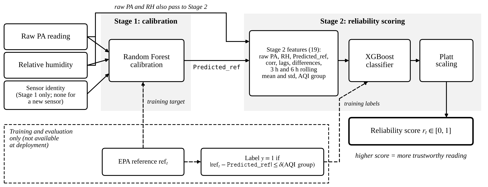
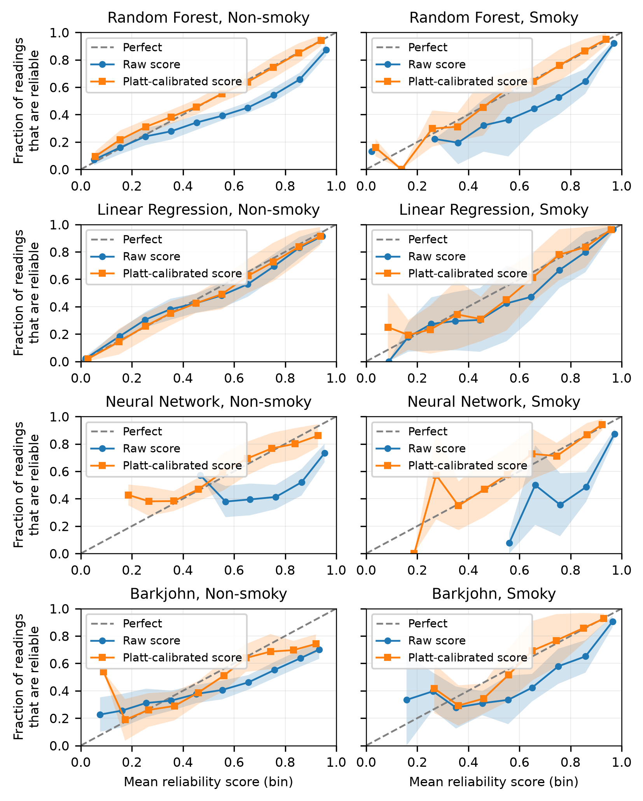
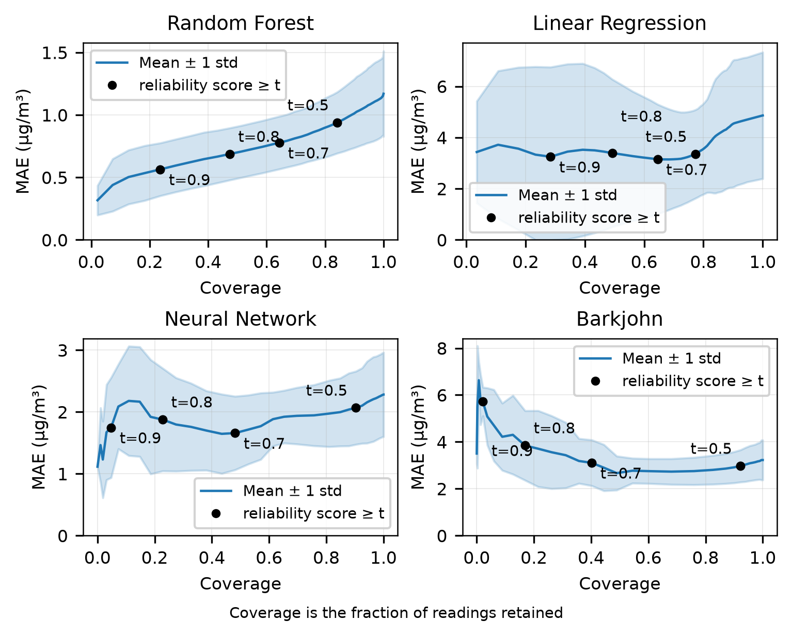

# A Two-Stage Reliability Score for PurpleAir PM2.5 Readings Under Wildfire Smoke

Code for the IEEE Access paper of the same name. Everything reported in the paper has a script here, grouped in the order the paper presents it.



**Stage 1** calibrates the raw PurpleAir reading (`PA`) with relative humidity (`RH`) and sensor `id` to an EPA-equivalent value, `Predicted_ref`. A Random Forest is used; Linear Regression, a neural network and the published Barkjohn formula are compared.

**Stage 2** scores how reliable each calibrated reading is, with an XGBoost classifier on 19 features (no sensor id) followed by Platt scaling. A reading is labelled reliable when `|ref - Predicted_ref| <= δ`, where δ is the mean Stage 1 error of its AQI group (Non-smoky: `Predicted_ref <= 35.4` µg/m³, Smoky: above).

Evaluation is sensor-disjoint: ten repeated splits over sensors (15 train, 6 calibration, 6 test), PR-AUC as the main metric.

## Evaluation regimes

| Regime | What Stage 1 is allowed to see | Folder |
|---|---|---|
| **R1** original protocol | random rows of all sensors, with sensor id | `stage2/`, `internal/r1_*` |
| **R2** known sensors, later readings | only each sensor's earlier 80% of rows | `internal/r2_temporal_audit.py` |
| **R3** cold start | only the 15 training sensors, no sensor id | `internal/r3_coldstart.py` |
| **R4** external | sensors from other sites and periods | `external/` |

## Paper to code

| Paper item | Script |
|---|---|
| Table I, AQI distribution | `tables/table_01_aqi_distribution.py` |
| Table II, Stage 1 bin-wise RMSE | `tables/table_02_stage1_binwise_rmse.py` |
| Stage 1 candidates (Table VI) | `stage1/random_forest.py`, `linear_regression.py`, `neural_network.py`, `barkjohn.py`, then `stage2/candidates.py` |
| Stage 2 classifier comparison (Table VII) | `stage2/classifier_comparison.py` |
| Stage 2 features, XGBoost parameters, Platt scaling | `stage2/pipeline.py` |
| Internal R1 tables: aggregate metrics, threshold sweep, bin-wise, δ values | `stage2/candidates.py`, `tables/stage2_tables.py` |
| R1 safety diagnostics (coverage, false-accept) | `internal/r1_safety_diagnostics.py` |
| R1 feature ablation | `internal/r1_feature_ablation.py` |
| R1 robustness to the Smoky δ | `internal/r1_delta_robustness.py` |
| PA-and-RH-only ablation row | `internal/pa_rh_only_ablation.py` |
| R2, temporal audit | `internal/r2_temporal_audit.py` |
| R3, cold start, and its coverage at absolute thresholds | `internal/r3_coldstart.py`, `internal/r3_coldstart_coverage.py` |
| Sensor-identity diagnostic: audit, ablation, safety | `internal/sensor_identity_audit.py`, `sensor_identity_ablation.py`, `sensor_identity_safety.py` |
| Tolerance sensitivity (looser out-of-sample δ) | `internal/tolerance_sensitivity/` |
| Nested re-tune of the Stage 2 XGBoost | `internal/nested_retune/` |
| External: Missoula and NYC Bronx | `external/missoula_nyc_bronx.py` |
| External: Los Angeles, single site | `external/los_angeles_single_site.py` |
| External: Los Angeles 2025 scoring | `external/los_angeles_2025/` |
| External: West Coast 2020 | `external/west_coast_2020/` |
| External: cf_1 re-pull of the PurpleAir field | `external/cf1_repull/` |
| Figures 2, 3, 4 | `figures/make_paper_figures.py` |

## Figures

All figure files are in `figures/` and are rebuilt from `results/` by `python figures/make_paper_figures.py`.

| Paper figure | File |
|---|---|
| Fig. 1, pipeline | `fig1_two_stage_pipeline.png` |
| Fig. 2, Random Forest calibration | `rf_scatter_ref_vs_pmcal.png`, `rf_calibration_error_hist.png` |
| Fig. 3, reliability diagrams | `combined_reliability_diagrams.png` |
| Fig. 4, coverage vs MAE | `combined_pareto_curves.png` |




## Run it

```bash
python -m venv .venv && source .venv/bin/activate
pip install -r requirements.txt           # pinned versions, see Reproducibility
# put the data files in data/ (see data/README.md)
python run_all.py                          # Stage 1, Stage 2, R1 to R3, external on data/
python run_all.py stage2 table_01          # or selected steps (names are in run_all.py)
python figures/make_paper_figures.py       # figures
```

Outputs go to `results/` (override with `PA_RESULTS_DIR`); inputs are read from `data/` (override with `PA_DATA_DIR`). `stage1_lr` and `stage1_nn` run before `stage2`. The scripts in `internal/tolerance_sensitivity/`, `internal/nested_retune/`, `internal/pa_rh_only_ablation.py` and `external/west_coast_2020|los_angeles_2025|cf1_repull/` take their input files as arguments; see the first lines of each script.

## Data

The hourly PurpleAir and EPA data are not redistributed. `data/README.md` lists the files to place in `data/`. The three frozen Stage 2 artefacts (`column_transformer.pkl`, `platt.pkl`, `trust_pipe.pkl`) are included.

## Reproducibility

- **Pinned environment.** The frozen `.pkl` files were saved with scikit-learn 1.5.1 and XGBoost 2.1.x and only load with those versions. `requirements.txt` has them.
- **Frozen Random Forest predictions.** The original Random Forest model file (833 MB) is not distributed. Its predictions were exported once and are read from `data/rf_pred_all.csv` and `data/rf_pred_{Missoula,NYC_Bronx,LA}.csv`. `stage1/random_forest.py` refits the model with the same architecture and seed and reproduces the reported test metrics (MAE 2.356, R² 0.9859, RMSE 5.62); that refit is only used to report Stage 1 metrics.
- **Smoky δ.** Non-smoky δ is 0.982 µg/m³. The canonical Smoky δ is 9.697 µg/m³, the mean error over training and calibration readings with `Predicted_ref` above 55.4. The mean over the full Smoky group (above 35.4) is 7.684 µg/m³; `internal/r1_delta_robustness.py` compares the two.
- **Neural network row.** The paper's neural network row comes from the original training run, which did not fix the TensorFlow seed. `stage1/neural_network.py` seeds NumPy and TensorFlow and reproduces its own output, but Keras is not bit-reproducible across machines, so its Stage 1 MAE (about 2.34) and the Stage 2 numbers derived from it can differ from the paper's neural network row (MAE 2.315) by about 0.01. The Barkjohn row is a fixed formula and reproduces exactly.
- **Seeds.** Every random component is seeded (`random_state=42`, with `+rep` and `+100+rep` offsets for the two sensor-level splits of repeat `rep`). Differences in the third decimal across library builds are possible.
- **Optuna.** The Stage 2 hyperparameters in the paper are fixed values from the original tuning studies and are reused unchanged. Optuna is only run in `internal/nested_retune/`, which re-tunes the XGBoost classifier inside the training sensors (25 trials, TPE sampler) as a check.

## Layout

```
config.py, run_all.py, requirements.txt, LICENSE
data/        inputs and frozen Stage 2 artefacts
stage1/      calibration candidates
stage2/      reliability classifier, candidate comparison, classifier comparison
tables/      Tables I, II and the internal Stage 2 tables
internal/    R1, R2, R3, sensor-identity diagnostic, ablations, tolerance sensitivity, nested re-tune
external/    Missoula, NYC Bronx, Los Angeles, West Coast 2020, cf_1 re-pull
figures/     paper figures and make_paper_figures.py
results/     outputs
```

## License

See `LICENSE`.
